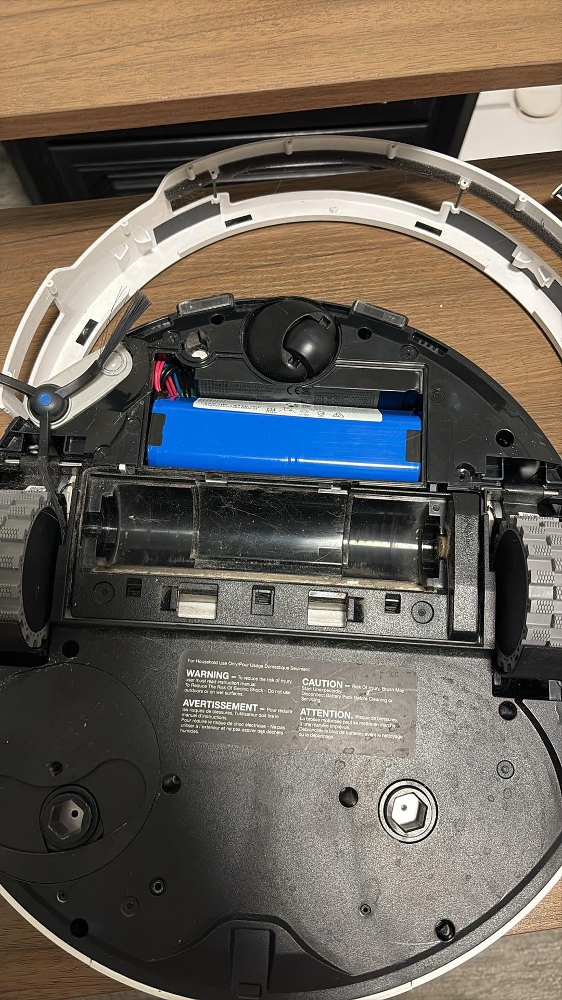
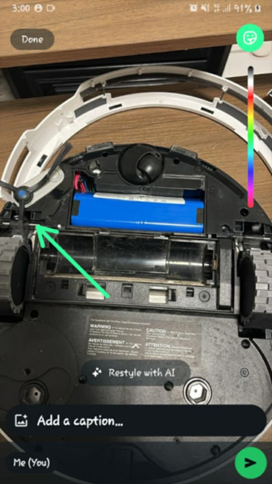
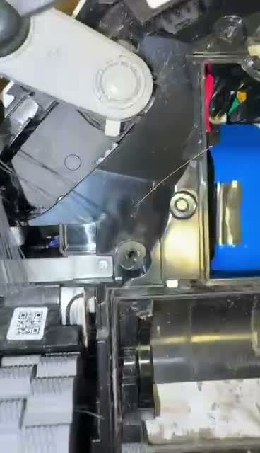
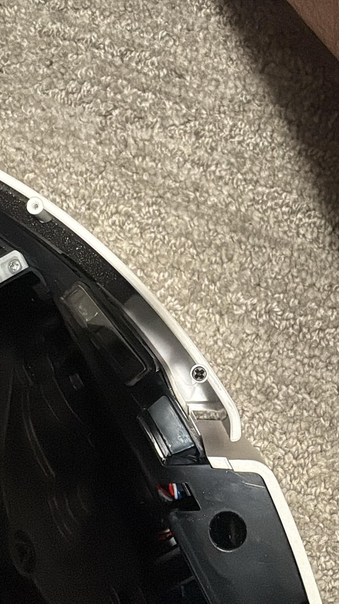
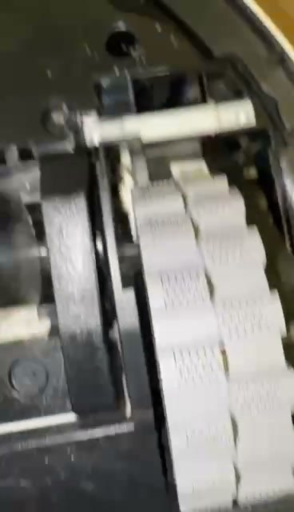

# ECOVACS DEEBOT T50 Pro Omni — Wheel Replacement Guide

> Replace both drive wheels, get the bumper off and back on correctly, and clear “Wheel Speed Sensor Error” and “Wheel Stuck” afterwards.

> **Source:** one real, successful repair in July 2026, checked frame-by-frame against a screen recording of the Messenger conversation. See “Checked against the recording” at the end for what was corrected.

*Figure 1 — Underside with the bumper removed. Blue battery pack at the top, main brush housing in the middle, and a drive wheel on each side. This is the view you start from.*

The helper in the original conversation is not an Ecovacs employee. He is based in Indonesia, works in tech, and pointed out that the T50 is not officially sold in Indonesia — but that Ecovacs disassembly is pretty much the same across models. That general Ecovacs pattern is exactly what this repair confirmed, especially for the bumper.

The owner put the difference plainly during this repair: it was “way different than the Dreame vacuums. Those I could repair without even a manual.” On the T50 Pro Omni, expect the bumper, the battery, and hidden screws under the battery to matter — follow the order in Steps 2–3 rather than assuming the shells will lift once the obvious screws are out.

## Before you open it

### Know the two error messages — they are not the same

This robot showed two different messages at two different stages, and keeping them separate makes troubleshooting much clearer.

- Wheel Speed Sensor Error — the original fault family. The robot was reporting that it could not correctly read how fast a wheel was turning. That points to the wheel module's speed sensor, its wiring, or a motor that is no longer turning as commanded.
- Wheel Stuck — the later message, after two new wheels had been fitted. In that instance the robot had still finished its clean, returned to the dock, and the app was showing “Drying Mop” — so “stuck” did not mean it was physically stranded in the room. A reboot cleared it on the next test run (Step 8).
- No error, but poor driving — check the basics first in every case: hair and debris around the wheel, the wheel's spring travel up and down, and whether the tyre tread is clogged. Do not open the robot for a fault you can clear from outside.

### Tools and parts you need

Replace the module, not just the tyre. The motor, gearbox, wheel and speed sensor come out together as the unit in Figure 9, with its wiring loom already attached. That is the part that was swapped in this repair — both sides.

## Step 1 — Power down and prepare the underside

1. Take the robot off the OMNI dock and switch it off. Remove the mop pads / mop assembly and empty the dustbin so nothing spills when you flip it.

2. Flip it onto the towel, underside up. You should now see the layout in Figures 1 and 2: front caster ball at the top, blue battery pack below it, side brush on one side, the wide main-brush housing across the middle, and the two grey-tread drive wheels left and right.

3. Clean first. Pull hair from around both drive wheels and the caster, and press each drive wheel in and out. It should spring back smoothly. A wheel packed with hair can mimic a failed wheel.

4. Photograph the underside before any screw comes out, especially around the bumper edge and the side brush (video still, Figure 3).

*Figure 2 — Underside overview with the white bumper arc detached and laid above the robot (screenshot from the repair). The green arrow points to the side-brush / front-edge area. Blue battery, main-brush housing and both drive wheels are visible.*

*Figure 3 — Video still: side-brush mount, front chassis screws and the edge of the blue battery pack. Work this front area carefully — clips and sensor windows sit close to the screws.*

## Step 2 — Remove the bumper: this is the step that blocks everything

1. Find the bumper screws around the front and front-side edges of the underside and along the bumper seam. Keep them in their own group in the tray — they are the small screws you will meet again in Step 7.

2. Ease the bumper forward and off once its screws are out. Work around its arc evenly, freeing clips a little at a time. Do not yank one corner: the bumper carries sensor windows and wiring described in Step 4.

3. Set the white bumper shell aside exactly as in Figures 1 and 2 — you can see its inside face, mounting posts and the black sensor strip. Note which way up it sits and where its centre notch is. Reassembly depends on that notch (Step 7).

4. Check the bumper edge detail in Figure 4: the silver/white bumper trim, a Phillips screw through it, a white plastic post from the other shell, and the coloured wheel wires just visible below. That overlap is why the shells cannot separate while the bumper is still screwed on.

*Figure 4 — Bumper edge close-up. A small Phillips screw holds the bumper trim to the chassis, next to a white locating post. The bumper overlaps the black chassis — until these screws are out, the shells stay trapped.*

*Figure 5 — Video still: drive-wheel tread and its suspension mount from underneath. Check this travel by hand before and after the swap — the new wheel should sit and spring the same way.*

## Step 3 — Battery out, check underneath, then pull the top cover off by hand

Do this in this order. Do not use a pry tool around the seam as the primary method — that is not how this repair was done. The helper's method was a hand pull, after the big screws and the battery were out.

1. Remove all the big screws first, grouped by location. If you started with the bottom screws (as in this repair), this is completing that set now that the bumper is free.

2. Take the battery out first. In the helper's words: “you can take batteey [battery] out frist [first]”. Lift the blue battery pack out of its bay (Figures 1–2) and set it aside away from screws and tools.

3. Check for screws under the battery. Again in the helper's words: “Usually there are still screws under the battery.” Remove any you find and keep them with the battery group. Then: “If it has been confirmed that there are none, please proceed.” Do not pull the cover until you have checked.

4. Pull the top cover off by hand, exactly as the helper described: “If all the big screws have been removed. You just need to open the top cover by 'your left hand holding the dustbox area and your right hand pulling up the back part of the top cover. It does require a bit of force'. If all the big screws have been removed it will come off easily.” Hold the dustbox area steady with your left hand and pull up the back part of the top cover with your right hand. A bit of force is expected.

5. If it will not come off, stop and re-check, do not lever harder: a big screw is still in, the bumper is still holding it, or a screw under the battery was missed.

6. Lay the opened robot out and orient yourself using Figure 6 before touching any wiring.

*Figure 6 — Inside, top shell removed. Green mainboard across the top, white dustbin bay in the centre, round suction fan below it, and the black wheel / mop-drive modules at the lower right and left edges. The coloured looms clipped across the white housing are the ones you will be routing again — photograph them now.*

What you are looking at in Figure 6: the mainboard is the large green board; below it is the white internal housing with cable clips holding bundles of red, blue, yellow and black wires; the circular unit near the bottom centre is the suction fan/motor; and the drive-wheel modules sit in cavities at the sides/rear, partly under black covers with QR-code labels. Nothing in this centre area needs to be removed to change a wheel — work only on the wheel cavity and its connector for the side you are changing.

## Step 4 — Find the wheel module, its connector, and the blue wire

Zoom in on one side at a time. Figures 7 and 8 show the same area from slightly different angles — mainboard on the left, white housing with clipped looms in the centre, and the black wheel motor sitting in its cavity at the bottom.

*Figure 7 — Wheel cavity and mainboard, one side. The white arrow drawn during the repair points along the white housing toward the wheel cavity. The wheel motor (black cylinder, bottom right) sits below the housing; its multi-coloured loom runs up to a plug on the green mainboard at the lower left.*

*Figure 8 — The same area, closer. You can see the wheel motor's white end cap and shaft in its cavity, the grey grommet/retainer where its loom passes through, and — at the lower left, in blue, red and green — the shared connector wiring. Compare your side with both photos before unplugging anything.*

- Photograph the connector for the side you are changing: plug position on the mainboard, wire colours, how the loom sits in the white clips, and where it passes through the grey rubber grommet.
- Note the end of the blue lead. On the removed module (Figure 9) the blue lead is much longer than the motor wires and ends in a small black-and-metal fork. Note where that fork sits before you move anything, and put it back in the same position on reassembly, not trapped under the module.

## Step 5 — Remove the old wheel: pin first, then spring, then the grey rubber

No wheel-module screws were visible in this repair. The owner said at 3:56pm: “It looks like I need to disconnect the spring but not seeing any screws on first glance.” Do not go hunting for module retaining screws as the method — the helper's method was the pin and the spring, in that order.

1. Unplug the wheel connector from the mainboard by the plug body, not by the wires. The photos (Figures 7–8) show the loom, its white clips and the grey grommet as orientation for routing — free the loom from the clips and ease the grommet out so the loom can follow, and keep the grommet.

2. Remove the wheel retaining pin first, which is underneath. In the helper's words: “You need to remove the wheel retaining pin first, which is underneath, then you can remove the spring.” Pin first — do not start with the spring.

3. Then remove the spring. Only once the retaining pin underneath is out, disconnect / remove the spring the owner had spotted.

4. Transfer the grey rubber piece with tweezers. The owner: “Looks like I need to grab tweezers and grab the gray piece then swap everything over.” The helper confirmed: “Yes, the gray rubber will be used on the new wheel.” Grab the grey rubber with tweezers, move it to the new wheel, and do not discard it — it is reused, not a spare leftover.

5. Lift the wheel / module out of its cavity. It sits motor-inboard, wheel-outboard. Note its orientation and how the suspension sits. Do not remove the centre fan, dustbin housing or mainboard.

6. Keep left and right apart. Lay each old wheel beside its side of the robot. If you are changing both — as in this repair — do one side completely before starting the other, so you always have the untouched side as a reference.

7. Set the old wheels aside for testing. Do not throw them away yet — see “Testing a removed wheel” to work out which one actually failed.

*Figure 9 — A drive-wheel module fully removed, with the top shell above it. Bottom: grey-tread wheel and black hub; centre: cream motor end with QR label and red/black motor wires; top right: the gold multi-pin plug, the twisted multi-colour motor/sensor loom through its grey grommet, and the long separate blue lead ending in its small metal fork (centre). Everything in this picture is one replaceable unit.*

## Step 6 — Fit the new wheel module

1. Compare old and new side by side first: same side (L/R), same plug, same wire colours, same grommet position, same blue lead and fork. If the plug or loom differs, stop — do not modify the connector.

2. Fit the grey rubber you transferred in Step 5 onto the new wheel before it goes in — it is reused from the old wheel.

3. Seat the new wheel / module in its cavity in the same orientation as the old one, then refit in reverse order: spring, then the wheel retaining pin underneath, so the wheel is held as it was before removal. Check the suspension moves freely.

4. Route the loom exactly as photographed: through the grommet (grommet fully seated in its hole), under/through the white clips, with no wire pinched under the module or stretched tight across the white housing, as in Figures 7 and 8.

5. Reconnect the plug firmly until it is fully home. The photos show the blue lead shares this wheel connector, so check that lead is seated with it. Give the plug body a light tug-check — nothing should back out.

6. Repeat for the other side if changing both, then spin each new wheel by hand and press it in/out once more before closing up. Both should feel the same.

## Step 7 — Reassemble — and the unanswered bumper-screw question

1. Mate the two shells evenly, checking no loom is visible in the seam. Refit the bottom screws in their original groups, snug but not forced. Refit the battery if you removed it in Step 3, and the top cover in reverse of the pull in Step 3.

2. Seat the bumper into its notch along its whole arc, as flush as you can get it, with no obvious gap at the centre or corners.

3. Refit the small bumper screws, checking each one as you go (see the note below).

4. Refit the side brush, mop assembly and dustbin, flip the robot upright, and return it to the dock for Step 8.

- Do not leave bumper screws loose as a finished state. Reseat the bumper fully in its notch and check alignment before tightening each screw.
- If a screw still spins freely after reseating and checking alignment, treat it as something to inspect — stop, look at that fixing point, and do not force it or substitute a longer screw. This guide cannot say from the chat whether that would be normal, a seating issue, or a damaged fixing.
- Work around the bumper tightening a little at a time, so it pulls down evenly and stays in its notch.

## Step 8 — First power-on, the 7-second reboot, and the test run

In this repair, fitting the two new wheels brought the robot back to life immediately — “Holy crap, it works again!” What happened next is worth expecting, because it can look like the repair has failed when it has not.

1. Dock and power on. Let the robot charge and complete its dock cycle. Check in the app that it recognises the dock and that no error is showing before you start a clean.

2. Run a short test clean in the room with the dock (in this home, about 20.9 m² in total). Watch the first minutes: straight driving, turns on the spot, and climbing any threshold. Listen for a wheel clicking, dragging or stopping.

3. If “Wheel Stuck” appears after a clean that otherwise completed — as it did here, with the robot back at the dock and the app showing “Drying Mop” — do not strip it down again straight away. First reboot it as below.

The “Wheel Stuck” screenshot in the app also printed its own solution, word for word: “Clean up the foreign objects on the driving wheels with tools. If the issue persists, please contact our after-sales service.” Do that clean-up check first — it is the manufacturer's printed first step for this message — before assuming a new wheel has failed.

Keep notes from the first week: date, message wording exactly as shown, whether the robot finished and docked, and whether a reboot cleared it. That log is what separates a settling-in glitch from a second failing module if you need to talk to a seller.

## Troubleshooting — match the message to the action

## Testing a removed wheel — which old one was actually bad?

The owner kept both old wheels and asked how to tell which one had failed, including whether a multimeter would do it. The helper's method is simpler and answers most cases without meter readings, for which this guide gives no invented values:

- Spin it by hand. Turn the wheel of the removed module with your hand, feeling for resistance through the gearbox/motor. Heavy, stiff or gritty rotation compared with the other module points to a weak or failing motor/gearbox — that module is the faulty one.
- If it spins freely and smoothly, suspect the sensor. A free-spinning motor with a speed-sensor fault will still have triggered “Wheel Speed Sensor Error” in the robot, because the robot could drive the wheel but could not read its speed back.
- Check the sensor with an Android camera. The wheel's speed sensing uses an infrared (IR) emitter/sensor arrangement. An Android phone camera can often “see” IR that your eye cannot: view the sensor area through the camera while the unit is powered in a test setup and look for the IR glow described by the helper. No glow where the good module shows one supports a dead sensor/emitter. Only do powered tests if you are confident and safe doing so — the hand-spin comparison alone is enough to decide which module to keep as a spare and which to discard in most cases.
- Label the result. Write “GOOD — spare” or “FAULTY — motor” / “FAULTY — sensor (suspected)” on tape on each old module and store the good one with the robot's tools. An unlabelled pair will be a mystery again in three months.

### Why does the wheel speed sensor error happen?

No single proven cause was established in this conversation, and this guide does not present one as fact. Mechanically, the error means the robot's reading of wheel speed disagreed with what it commanded — which a worn motor, damaged sensor, or damaged loom in the module will all produce, and which is why replacing the whole module fixed it here.

The owner also raised what he had read online: that wheels on these models seem to break every few months for some owners, and that some people suspect a firmware issue. That is included here exactly as it was raised — as an owner-reported pattern and a suspicion to watch, not as a proven cause. The practical takeaways are to keep the robot's firmware and app up to date through the official app, keep your reboot/test notes (Step 8), and keep a known-good spare module (next section) if your robot is out of warranty and in daily use — this robot vacuums five days a week, so downtime matters.

## Buying a backup pair — what this repair actually showed

- What worked here: the replacement wheels for this repair came from AliExpress and were still working at last follow-up, and the owner decided to order a backup pair on that basis.
- What was not claimed: the helper explicitly said he could not advise on global stores, as he had never bought from them, but offered that he might be able to help with other spare parts he happened to have. This guide therefore makes no “best place to buy” claim.
- Before you order any backup, check: T50 Pro Omni listed explicitly (not just “Ecovacs”); left, right, or pair — and which you are getting; plug and wire colours matching Figure 9; long blue lead and fork included (owner identified it as a replacement limit switch); grey grommet fitted on the loom; and clear photos of the motor end and QR label to compare with your old module.
- On arrival, test before you need it: hand-spin both modules, compare plugs, and store them labelled L/R in a dry box with this guide. A backup that does not fit is not a backup.

## Using this guide as a Google Drive / Google Docs document

This file is a standard Word (.docx) document with all photographs embedded in the file itself — no linked images — so it transfers to Google Drive intact:

1. In Google Drive (web): New → File upload → choose this .docx file. Once uploaded, double-click it and choose Open with Google Docs. Drive keeps the original .docx and creates an editable Google Docs copy with the images in place.

2. In the Drive mobile app: + New → Upload → pick the file from your downloads/files, then open it and use Open in Docs if you want to edit or share it.

3. Sharing: use the Google Docs copy's Share button to send it to a helper or keep it with the robot's records. Check the first page after conversion — headings, tables and figure captions should all be present; if you share it, share the Docs copy, not a screenshot of it.

4. Offline on the bench: keep the .docx (or a PDF print of it) on the phone you use for step photos, so you can zoom Figures 6–9 while your hands are on the robot.

## One-page checklist — tick off as you go

## Photo index — what each figure shows

Source note: Steps, error wording, usage figures (3 months, vacuum 5 days/week, mop 3 days/week, about 20.9 m²), the 7-second Wi-Fi-button reboot, the hand-spin and Android-camera sensor checks, the AliExpress purchase, and the no-warranty (second-hand reseller) context are all from the owner's Messenger conversation about this repair in July 2026. No screw counts or torque values are given in that conversation or visible in the photos, so none are invented here — keep screws grouped by location instead.

Acknowledgement: thanks to the technician in Indonesia who talked this repair through step by step — including the bumper and the reboot — without ever having a T50 officially sold in his market.

## Checked against the recording — what changed in this revision

The broad order of the first version was confirmed against a 60-second screen recording of the chat, frame by frame: disassembly on July 18 (bumper, top cover, wheel swap), the 5:23pm bumper reassembly question, then “Holy crap it works again!” at 8:47pm, the Wheel Stuck message, the reboot, the old-wheel test, and the AliExpress backup question the next day. That sequence has not been reordered. Three material errors in the first version were corrected:

- 1. Top cover (Step 3): removed an invented pry-tool method and added the helper's actual hand-pull method, plus the omitted battery step — battery out first, check for screws under the battery, only then pull the top cover.
- 2. Wheel removal (Step 5): removed invented wheel-module retaining screws and added the actual sequence — retaining pin underneath first, then the spring, then transfer the grey rubber to the new wheel with tweezers (it is reused).
- 3. Bumper screws (Step 7) and blue wire (Step 4): corrected the attribution. The bumper-screw question was never answered by the helper — the owner self-resolved it (“Nevermind sorry lol / Good to go!”) — so the guide no longer presents a diagnosis as fact. The blue lead's identification as a replacement limit switch was the owner's own, not the helper's confirmation, and is now attributed that way; the photos show only that it shares the wheel connector.
Also added in this revision: the owner's Dreame comparison in Step 2 context, and the app's printed Wheel Stuck solution in Step 8 and the troubleshooting table.

## Troubleshooting

| What you see | Most likely meaning | Do this, in order |
|---|---|---|
| Wheel Speed Sensor Error | Sensor in the wheel module not reporting, damaged sensor wiring, or a motor no longer turning as commanded | 1) Clean around wheel 2) Hand-spin check 3) Check that side's plug / grommet / loom |
| Wheel Stuck — robot stranded mid-room | Wheel physically jammed, lifted, or suspension stuck | 1) Free debris / hair 2) Check spring travel 3) Check loom not pinched |
| Wheel Stuck — but robot finished, docked, “Drying Mop” | As in this repair: a reported state, not a physical stranding | 1) Reboot (Wi-Fi button, ~7 sec to reboot sound) 2) Short test clean 3) Only strip down again if it repeats |
| Bumper errors / no bumper “click” after repair | Limit switch disturbed — blue lead / fork not back in place, or its shared plug loose | 1) Reseat shared plug 2) Check blue lead routing and fork position 3) Check bumper seating |
| Bumper screw spins, bumper loose | Bumper not fully seated, shells not mated, or post stripped/cracked | Reseat bumper + mate shells, then retry. If still spinning, inspect/repair the post |
| One side drives, robot circles | One module unplugged, wrong side fitted, or loom pinched | Stop, power off, check that side's plug, L/R correctness and loom routing |
| Error returns every run after reboot | Not a glitch — a module, sensor or connection fault remains | Test both removed/new modules, swap sides only as a diagnostic if you are comfortable doing so |

## Checked against the recording — what changed in this revision

- **Top cover:** battery out first, check for screws under the battery, then left hand holding the dustbox area, right hand pulling up the back part of the top cover. It does require a bit of force.
- **Wheel removal:** retaining pin underneath first, then remove the spring. Tweezers to grab/transfer the gray rubber piece to the new wheel — it is reused, do not discard it. No screws were visible on first glance.
- **Bumper screws (Jul 18, 5:23pm):** the helper never answered this question in the chat; the owner self-resolved it with “Nevermind sorry lol / Good to go!” This guide therefore cannot conclude why the screws seemed unconnected. Do not leave bumper screws loose; reseat the bumper fully and check alignment before tightening.
- **Blue wire:** the owner self-identified it as a replacement limit switch; the helper never confirmed it. The blue lead shares the wheel connector.
